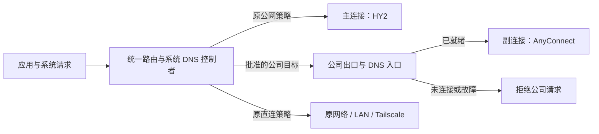

# 公网主连接与公司内网副连接：边界和方案

实施更新：已构建首轮隔离测试包并完成部分 G0 回环子项；真实物理网络、系统 TUN/DNS、公司业务和 Finder SMB 尚未验收。当前实现、签名包与证据口径见 [测试构建记录](DUAL_CONNECTION_TEST_2026-11-07.md)。本文件下方保留方案评审时的历史状态。

日期：2026-11-07。状态：已完成 Claude 首轮与 Agy 分块静态审查，由 Codex 审核纠偏；隔离原型、产品实现及真实双连接验收尚未开始。最新复核见 [分块独立审查记录](DUAL_CONNECTION_REVIEW_2026-11-07.md)。

源码事实基于默认分支 `5837d903321e2d461540553102586ff0132e63ce`（1.0.8 发布验收记录）；本轮不改变正在运行的 App、特权服务、VPN、用户配置、签名或更新源。原工作区的既有改动保留。

## 目标与第一版边界

保持原来的公网主连接和 App/直连规则，增加一条仅供公司内网使用的副连接。副连接认证失败、掉线、断开、重连时，公网主连接继续工作，公司目的地拒绝访问而不回落至公网。

| 项目 | 第一版建议范围 |
| --- | --- |
| 主连接 | 一条已支持的 HY2 订阅线路；现有全局/按名单代理行为保留 |
| 副连接 | 一条 AnyConnect，沿用当前可用的认证能力；不新增浏览器 SSO、端点检查绕过或认证体系 |
| 公司目标 | 用户批准的 RFC1918 私网和完整域名；服务器下发信息只是候选，不自动接管全部私网或默认路由 |
| 公司 DNS | 仅指定公司域名经副连接访问公司 DNS；优先验证 TCP 53，不能向主连接 DoH 或原网络兜底 |
| 首批业务 | IPv4 的内网页面、SSH、SMB/TCP，逐项验收；IPv6 公司出口单独放行，未启用时公司 AAAA 不能落到其它出口 |
| UDP/ICMP/发现协议 | AnyConnect UDP 未修复、未重新验收；不作为首批已支持能力。依赖 UDP 的业务、ICMP 和广播/mDNS 发现另行定范围 |
| 公司网关传输 | 走原网络并明确绑定/固定网关，不做 VPN 套 VPN；若公司网关只能经主连接到达，另评估 |
| 其它网络 | 保留 LAN、Tailscale、既有国内直连和公网 AI 策略；冲突先拒绝，不自动重写 |
| 自动化 | 默认关闭；用户显式选择公司线路并连接，不自动登录、切换出口或故障转移 |

公司服务器若要求强制全隧道、现有客户端不能满足的认证或设备检查，应报告不支持；不通过本地路由改写绕过其要求。

## 当前源码能证明的事实

| 现状 | 证据与影响 |
| --- | --- |
| 一个特权路由会话 | `service.go:handleServiceConnection` 用全局 `active.CompareAndSwap` 拒绝第二个 route worker；不能直接删除互斥 |
| 还有其它独占约束 | `app_capture.go` 的捕获锁、`session_recovery.go` 的存活 worker 检查及 `transparent_routing.go` 的路由所有权校验共同限制并发；不能通过第二个 RouteClient 绕过 |
| 恢复日志不是任意路由表 | `session_recovery.go` 对捕获前缀、数量和所有权有严格限制；不把新增公司网段塞入旧 `transparent-` 日志 |
| GUI 连接状态只有一份 | `AppStore.swift` 的 `phase/token/socksPort/trafficMeter` 与 `handle/stopAll` 共用；副连接错误不能继续调用全局停止路径 |
| 每个 TransportClient 只管理一个子进程 | `TransportClient.swift:start` 与 `generation`；可新增第二实例，但必须为事件和停止操作增加所属会话 |
| OpenConnect 已在用户态传输 | `main.go:packetPipe` 与 `bridge/stack.go`；ready 已包含地址、DNS、网关和远端网段，不代表第二条连接已有生命周期支持 |
| 公司网段当前复用单一出口 | `transparent_routing.go:makeTransparentConfig` 把 `RemoteNetworks` 指向同一个 `GoConnect` SOCKS；不能拿现有开关当作双出口 |
| DNS 当前只有原网络与主出口策略 | `managed_dns.go:configureManagedDNS` 使用原 DNS/接口和 `#GoConnect`；新增公司 DNS 必须同时约束查询目的地与传输路径 |
| 活跃透明会话没有企业策略更新事务 | `transparent_session.go` 启动时生成配置，运行时以健康和状态轮询为主；尚无不扰动主连接的 attach/detach 实现 |
| 透明入口已有范围校验 | `openControl → routeRequest.validate` 验证私网/数量，`transparentSession` 另调用 `companyPlan` 与 `validateCompanyGateway` 检查 LAN/Tailscale 重叠和主网关回环；不能因配置生成函数未重复校验就声称入口完全无保护 |

上述为静态核查；没有据此宣称 Web、SMB、DNS、UDP 或双连接已经实测通过。

## 建议架构

保留一个统一的特权路由控制者和系统 TUN。GUI 的连接协调器管理两个独立用户态传输，主 RouteClient 仍持有唯一 root lease；公司传输不自行安装默认路由、全局 DNS 或第二套全局接管规则。MVP 不新增 `service.go` action、不放宽 `active/captureLock`，也不把现有独立 `CompanyShared` worker 并行启动。

**优先原型：预留公司作用域与稳定本地入口。** 在主连接启动前选择公司配置，统一路由预置该作用域和公司出口入口；入口初始拒绝。副传输认证和探测通过后，只提交它的已验证 backend；副重连更换 backend 与 generation，不整份重载主内核。

“稳定”仅指同一控制者生命周期内的端口与入口；每次生命周期重新生成凭据。入口不能成为任意目的地的无鉴权本地代理。公司配置范围在主连接期间只读；启停副连接不修改范围。第一版不承诺在主连接工作时任意新增公司网段、修改域名或更换公司配置。

固定回环端口不等于服务身份，SOCKS 口令只证明客户端持有口令，不能阻止假服务接管旧端口。原型必须覆盖入口/bridge 退出后的端口复用：优先由仍存活的统一 worker 持有稳定入口，后端采用可验证 peer UID/PID/start-time 的 Unix 通道或经验证的服务端认证机制；不能只凭 `127.0.0.1:port` 和一次健康检查绑定新后端。未通过此门槛，不采纳单纯的 TCP 字节转发槽。

公司入口同时承担目的地约束，不使用盲转发：域名先经本会话受控 TCP DNS 解析，检查 CNAME 链与终端 A/AAAA，再确认 IP 位于批准公司 CIDR（或明确批准的 DNS 服务器单 IP/53 例外），最后以文字 IP 拨号。保留 TLS SNI、HTTP Host 等原始业务字节，不解密 TLS。公司业务 UDP 在首版快速拒绝，不能转给主出口；本地 DNS listener 仍须接收 macOS 的 UDP/TCP 查询，再转成公司隧道内 TCP DNS。

这是实际源码要求：SOCKS 域名 CONNECT 经 `bridge.Stack.DialContext` 进入固定版本 netstack 的 `LookupContextHost/exchange`，后者先尝试 UDP；文字 IP 则直接跳过查询。因此“仅系统 DNS 设为 TCP”不足以证明业务连接不再依赖 UDP。改造限定在公司角色的 resolver/dialer，不全局替换已有主连接或第三方 netstack 的行为。

此选择需先做隔离原型。如果现有内核需要重启 TUN、完整重载 DNS、清空所有连接才能挂载公司出口，则原型不通过；不能静默退化为中断主连接。备用的 provider/select 更新路径也必须证明同一组不扰动条件后才能替代。

当前 1.0.8 没有该预留入口和控制协议。以后安装包含此功能的版本及升级服务，仍需正常更新窗口；不承诺把新能力注入当前运行进程。

## 路由、DNS 与失败边界

预检在任何副连接路由变更前完成：规范化网段与域名，检查 LAN/Tailscale、已有直连地址、公司 DNS/域名、主副网关和 DNS 引导端点的冲突；公司域名解析所得地址/CNAME 不得借由未批准范围绕行。公司网关的解析和握手不能依赖尚未建立的公司 DNS。仅在隧道 ready 后取得 `VPNGATEWAY` 再补主机路由太晚，需在认证 socket 创建前验证原网络出站；不能仅靠可能识别失败的进程例外作保证。

外层路径优先原型验证：主连接接管前解析并批准有限的公司网关候选，复用现有 pin 函数固定至原物理网关；候选外的重定向/新网关必须在拨号边界拒绝或经过已验证的受限物理接口传输入口，不能先让握手进入主 VPN 再事后修正。OpenConnect 的物理出站绑定机制仍须原型，不把 `--interface` 当作已验证的物理绑定。

恢复日志已核实允许物理接口、合法网关、非 scoped 的单 IP 主机路由（`session_recovery.go:84-92`）；第二网关若满足相同约束，可复用 `pinTransparentGatewayWith`，**不必仅为第二网关新增日志格式**。启动前应计算全部捕获/物理默认/主副网关记录，保持总数不超过 16；首版超限直接拒绝，不自动扩容。任意公司 CIDR→TUN 仍不符合旧捕获记录白名单；若 Finder 等系统入口原型证明需要这类精确附加路由，再单独设计有所有权和版本边界的记录及恢复测试，不放宽旧校验。上述出站与系统入口选择均未通过 G0。

路由优先顺序建议为：

1. 回环、控制通道和已确认的主副网关路径。
2. 既有 LAN、Tailscale；与公司范围重叠时拒绝开启副连接。
3. 公司域名、批准网段及 DNS 服务器目标：只走公司入口；不可用即拒绝。
4. 原有直连域名/IP、主连接的 App 名单与最终策略。

公司规则不能被直连 App 或 `MATCH` 绕过。停止副连接时不能简单删除公司规则，否则全局主出口会接手这些请求。已预留的公司范围保持拒绝，直到结束主连接并显式编辑配置。

保留主连接当前嗅探能力，但公司目的地址不能因 SNI/Host 嗅探而被改写成另一地址后逃出公司策略。原型优先验证对公司 CIDR/DNS 目标跳过目的地址嗅探覆盖，再由公司入口核验最终 IP；官方 `skip-dst-address` 是可评估选项，须核对实际打包版本并实测，不通过全局关闭嗅探改变原公网行为。仅凭调高规则顺序不足以放行。

还需核对所有保留的显式本地代理入口（例如 `proxy-front`）是否使用同一公司策略，避免显式代理请求直接进入主 transport 而绕过统一路由。主动使用其它第三方代理、App 自带 DoH、绑定物理接口等路径需要明确范围，不能把系统接管描述为不可绕过的网络隔离。

DNS 的分域策略与流量路由分开校验：公司完整域名走预置的稳定本地公司 DNS 入口，再经副传输查询批准的服务器；AI/其它公网沿用主出口 DoH，国内直连与本地解析沿用当前策略。`ready.dns` 是候选元数据，不是批准或就绪证明；副上线后只在已预留作用域内更新公司入口的已验证 resolver/backend，不再次调用 `route.start` 重建主核心。若需要企业 supplemental DNS 租约，应与主连接一起准备并由同一控制者持有；副开关不释放或重建主/企业租约或 listener。

需覆盖 macOS supplemental resolver 的优先级、A/AAAA、TCP/UDP 本地请求、正负缓存、CNAME 与重连 generation。原生 resolver 有自身接口时优先使用该接口，否则才回退原网卡；不能把所有 private resolver 视为物理直连。域名与既有原生 resolver、直连规则冲突时先拒绝，不依靠字典后写入掩盖系统解析优先级。CNAME 追踪始终经同一公司 DNS，越界或失败直接拒绝，不能交给公网默认解析接管。未支持公司 IPv6 时，不发布不可用的公司 AAAA；已配置的公司 IPv6 范围若不能安全处理，拒绝启用。首版不添加全局搜索域、不拦截所有单标签名称。

保护范围限定为批准的公司网段/FQDN与可关联解析目标；未知的文字 IP、无法关联的旧缓存或 App 自带加密 DNS 不自动成为已识别公司流量，不据此宣称不可绕过的防泄漏。

不预设 macOS 或现用内核具备“按公司域名精确清空系统 DNS 缓存”的接口。优先让公司入口管理按 generation 隔离的缓存，验证系统正负缓存与 TTL 对启停的影响；已有缓存 IP 仍受公司网段拒绝规则约束。不能以全局清空 DNS 缓存或重启解析服务冒充无扰动更新，也不能承诺启用副连接后所有应用立刻遗忘旧解析。

公司 DNS 使用 TCP 的前提是服务器支持；不能以“避开 UDP”宣称此前 UDP 缺陷被修复。旧的 AnyConnect UDP 发布豁免不适用于本新增能力；业务若依赖 UDP，必须另做适用验收。

## 生命周期建议

| 事件 | 处理顺序与可见行为 |
| --- | --- |
| 启动副连接 | 校验范围/网关 → 认证 → 私有出口探测 → 提交企业 backend → 显示公司已连接；此前公司目标仍拒绝 |
| 副认证失败/用户取消 | 仅停止该副会话；主连接保持原状态；公司入口仍拒绝 |
| 副掉线/重连 | 先阻断旧 generation、关闭其企业流，再尝试新副会话；不用主出口兜底 |
| 手动断开副连接 | 获得阻断回执后停止副 transport，只清理其资源，不撤销公网接管 |
| 主短暂传输重试 | 不新增主会话自动重连能力；原主控制会话和统一路由存活时可保持副连接，任何主控制会话重建先停副 |
| 主切网或主会话异常结束 | 沿用现有 HY2 行为并级联停止副连接，不自动恢复或重放副密码 |
| 主手动断开/致命退出 | MVP 明示“结束主连接会一并结束公司连接”；先阻断公司入口、停副传输，再释放统一路由与主传输 |
| App 退出/共享 worker 故障 | 按所有权清理所有会话；不承诺共享控制面故障下主连接仍可工作，也不承诺进程退出后的永久网络阻断 |
| 安装更新/升级服务 | 下载仍可经主连接；安装和服务替换等待主、副、控制者及其清理均空闲，同时保留草稿保护 |

第一版不支持副连接在主连接结束后单独常驻。主节点切换与公司配置编辑先锁定；若要开放，必须补充两连接同时运行时的独立交接验收。

## 共享接口草案

所有协议由 Codex 先冻结，Claude/Agy 只消费约定字段，不各自修改同一路径。下面的 prepare/commit/block 是所属会话内的业务事务；如果由 root worker 持有稳定入口，只扩展该 worker 的有界控制消息并逐项鉴权，不增加通用 `service.go` action。不能把用户态 stdin 消息直接转成无约束 root 操作。

- 会话身份：`role(primary/company) + sessionID + generation`；错误、统计、取消和子进程回执均绑定身份，拒绝陈旧事件。
- 控制者：单一 `controllerID + owner UID/PID/start-time + lease`；保留现有签名、团队与精确 CDHash 校验。root 启动请求只增加可选、严格校验的公司预留字段；没有预留时保持原单连接路径。
- `StartController(primary, reservedCompanyScope)`：只接收有界结构化策略，返回控制者与 revision。
- `PrepareCompany(controllerID, expectedRevision, identity, endpointClaim, approvedScopeDigest)`：验证端口/进程归属、回环地址、作用域和网关；准备期间公司入口保持拒绝。
- `CommitCompany(preparedRevision, readiness)`：探测通过才原子提交 backend；失败回到公司拒绝态，主策略不变。
- `BlockCompany(expectedRevision, identity)`：阻断新请求并撤销旧 generation 流，回读成功后允许停止副 transport。超时/乱序不得放行。
- `DetachCompany`：只解绑副 backend，不把公司范围变为直连或主代理。

禁止任意 shell、任意系统配置路径、完整 Mihomo JSON、通用 root 命令执行。令牌、密码、私钥不进入报告/日志；主副认证按 profile ID 独立处理，主 token 不复用为公司 token。更新后的 root 请求必须有能力/revision 核对，旧服务不得把未知字段拒绝误判成成功。主副错误、隔离状态和密码弹窗分别管理，副弹窗不能吞掉“断开主连接”。

配置建议使用独立 `company-connection.json`（0600）引用现有 profile ID、保存批准网段/域名/DNS及启用状态，现有 `configuration.json` 的 schema 7 不升版。这样旧版正常保存主配置不会丢弃未知的副配置字段。回到新版后检查引用仍存在、主副不同、认证与范围仍有效；失效即关闭副连接配置并提示，不自动修复或连接。此方案仍须旧版加载/保存/回到新版的兼容测试，不能据文件分离就宣称数据回滚无损。

## 模块归属

| 所有者 | 负责模块 | 预计文件边界 |
| --- | --- | --- |
| Claude / Opus 5.5 high | 两个 transport 的状态机、认证与事件隔离、独立取消/重连/统计、更新保护状态聚合 | `Stores/AppStore.swift`、拟增 `Stores/ConnectionCoordinator.swift` / `CompanyConnectionStore.swift`、`Services/TransportClient.swift` 及相应生命周期测试 |
| Agy / Gemini 4 Argon medium（已完成分块静态审查，由 Codex 纠偏） | 企业作用域规划、稳定公司数据入口、企业 DNS 分发、冲突检查、路由/DNS 拒绝态和定向流清理；实现前冻结共享接口 | `transparent_routing.go`、`transparent_session.go`、`company_network.go`、`managed_dns*.go`、拟增 `company_egress.go` / `company_policy.go` 及其测试 |
| Codex | 共享 schema/IPC、特权鉴权和 lease、不扰动门槛实验、两模块集成、原生 UI 与整体验收 | 拟增 `GoConnectCore/CompanyConnectionConfiguration.swift`，`TransportProtocol.swift` / `RouteConfiguration.swift`、`Services/RouteClient.swift`、`route.go` / `route_command.go` / `route_status.go`、连接/菜单界面和验收记录；`service.go` 与既有恢复格式保持约束 |

新增文件名为设计建议；实现前固定精确路径。跨模块接口调整须先合并契约，再由对应所有者改实现。Codex 审完整 diff、补缺陷并执行集成验收，不仅汇总外部意见。

UI 沿用当前原生连接页面，增加公司连接的状态、认证与独立停止动作；菜单栏速率继续使用主连接数据，公司速率/当前会话统计单列，避免计入公网线路的套餐消耗。使用中的主、副 profile 均禁止编辑/删除或互换角色。此轮没有进行 UI 实现或渲染验收。

## 先验收什么

| 门禁 | 必要证据 |
| --- | --- |
| G0：隔离原型 | 在合成/隔离环境验证稳定入口的 attach/detach/reconnect，不重启主 transport、root core、TUN 或 DNS listener；持续主 TCP/WebSocket/下载与 DNS 为对照 |
| G1：身份与事务 | 迟到事件、旧 generation/revision、错误端口/所有者、端口复用/假 SOCKS 服务、重复提交、半途取消、回滚失败均不会作用到另一会话 |
| G2：路由冲突 | 默认/公网网段、LAN/Tailscale 重叠、直连域名冲突、网关包含在公司范围、IPv6 不受支持时在变更前拒绝 |
| G3：DNS | 系统真实解析公司域名确经公司 DNS；本地 UDP/TCP 查询都能经副 TCP 上游解析；SOCKS 域名 CONNECT 在禁用隧道 UDP53 时仍成功且无二次 UDP 查询；文字 IP 不触发解析；断副、NXDOMAIN、SERVFAIL、超时、缓存/CNAME、A/AAAA 不向主 DoH/原 DNS 回退；公网 AI 与国内/LAN 解析保持原路径 |
| G4：实业务 | 内网页面、SSH、Finder 实际 SMB 挂载/读文件分别通过；普通用户 HTTP 200 不代替内核 SMB 证据 |
| G5：故障隔离 | 副认证失败、掉线、网关变化、进程退出、重连与主动停止仅影响公司流；主出口、原直连与 LAN/Tailscale 对照持续正常 |
| G6：退出和更新 | 两会话清理、睡眠/唤醒、App/worker 崩溃、更新下载与安装互斥、服务升级和旧配置迁移均有证据 |
| G7：放行 | 通过后才另行安排安装/发布；执行现有签名、真实 OTA、四附件与签名更新源流程，本方案文档不构成发布授权 |

G0 先通过再安排后续编码。真实公司网关/网段/域名/DNS 与业务目标在实施前核实；只需非密码的连接元数据，认证在本机完成。公司测试依赖和需要替换正式组件的验收窗口单独安排，不在此次评审中触碰当前 VPN。

G0 分别验证外层拨号（含未知重定向拒绝）、稳定入口服务端身份、公司 DNS/文字 IP 拨号和主链连续性；Finder/kernel SMB 是独立硬门槛。若系统流量不能进入统一 TUN，不用普通用户 HTTP 通过替代，也不自动启动第二个特权 worker。副启停只执行所属会话的定向 block/drain，不调用要求所有 core/接口均已退出的全局 abandoned recovery。现有 `RemoteExcluded`、受端口/协议限制的服务端 split 条目与“无 include 列表”语义还需在策略输入中保留：没有明确批准时不把它们扩大成全部私网许可。

## 参考与证据口径

- [OpenConnect 手册](https://www.infradead.org/openconnect/manual.html)：`--script-tun` 可把 VPN IP 流量交给用户态处理；不是双连接验收证明。
- [Mihomo API](https://wiki.metacubex.one/api/)：存在配置/provider 更新与按 ID 关闭连接接口；不保证对现有 TUN、DNS 或连接无扰动。
- [Mihomo DNS 配置](https://wiki.metacubex.one/config/dns/)及 [DNS 类型](https://wiki.metacubex.one/config/dns/type/)：分域上游、指定出站与 TCP DNS 的语法基础，实际所用组件版本仍须测试。
- [Mihomo 域名嗅探](https://wiki.metacubex.one/config/sniff/)：目的地址覆盖与按目标网段跳过嗅探的配置基础；不代替打包版本兼容和流量验收。

## 首轮协作记录（历史）

| 参与方 | 请求与回执 | 本轮结论 |
| --- | --- | --- |
| Claude Code | 请求 `claude-opus-5-5` / `high`；调用完成，`modelUsage.canonicalModel` 回执匹配；平台未报告实际 effort，仅确认 high 请求已固定 | 完成生命周期、权限、锁、恢复日志、外层握手与配置兼容的只读源码审查 |
| Agy | 请求 `gemini-4-argon-medium` / `medium`；实时模型清单包含该 ID；首次传输空闲超时，同模型/档位/工作区续接一次后仍 `isError=true`；未提供可核实的运行模型/effort 回执 | 续接文字引用了快照中不存在的 `goconnect-network` / 构建脚本，并将当前 Mihomo 写成其它内核；不能作为独立源码验证通过，已拒绝其未经核实的实施建议 |
| Codex | 逐项阅读实际 `goconnect-transport` 源码、核对当前默认分支/正式版、校验外部只读工作副本未改动 | 接手路由/DNS 静态核查；制定共享接口、预留出口原型、身份/端口复用门禁、配置 sidecar、模块单写入者及整体验收矩阵 |

采纳 Claude 的单 worker/lease、预置出口、主结束时副级联停止、独立密码/取消/隔离状态建议。未直接采纳简单 TCP 中转槽、仅靠进程识别保证外层出站、往 schema 7 塞入会被旧版保存丢弃的字段；相关问题由 Codex 在本方案中收紧。Agy 结果中的公司公网段、私网一概旁路、任意公司路由日志，以及精确系统缓存清空等建议未采纳。

**首轮结论：方向可行，形成可评审方案；当时 Agy 的独立验证未完成。** 该历史记录不代表后续状态；最新分块审查见下节。G0 的稳定入口、服务端身份、外层物理绑定及 DNS 路径仍是进入产品实现前的技术门槛。

本轮仅新增本方案文档，没有产品实现、构建、安装或发布。原始回执、审查结果与 Codex 核查保存在项目外私有目录 `/Users/willhsu/.codex/visualizations/2026/11/07/goconnect-dual-vpn-plan/`；临时源码快照在调用结束后清理。

### 后续调用诊断

同日按用户要求再次诊断 Agy。原模型与 medium 档位不变，新会话的随机文件读取、CLI 流式对照和三份限定源码片段均成功；代码引用已由 Codex 核对。CLI `init` 自报模型和工作区匹配。详见 [Agy 调用诊断](AGY_DIAGNOSTIC_2026-11-07.md)。

因此，Agy 已恢复小范围调用/读码能力；上表中的原整模块失败记录保留，不能将本次诊断扩展为完整路由/DNS 独立审查通过，也不能将 API 流式空闲超时的底层原因视为已查明。

### 分块审查补齐与当前结论

按用户后续要求，已完成路由优先级、外层握手与系统入口、DNS 策略、DNS 租约/缓存、动态挂载、特权/恢复及补充的 SOCKS 二次解析共七项只读审查。六个初审均返回成功终态；两项过度判断经补充调用链更正，一项截断 DNS 报告另行补齐，另增加一项依赖代码审查。全部调用固定 `gemini-4-argon-medium` / `medium`，CLI `init.model/cwd` 与请求匹配；独立 effort 字段未返回。

Codex 逐项核对并完善本方案，没有照搬“完全无校验”“第二网关必需新日志”“TCP监听等于不支持UDP”“CNAME越界后交默认解析”等错误或过宽建议。完整证据覆盖、接受/拒绝项和验收映射见 [分块独立审查记录](DUAL_CONNECTION_REVIEW_2026-11-07.md)。

**当前已补齐的是分块静态独立审查及 Codex 纠偏；产品功能、隔离原型与真实双 VPN 均未验收。** 后续模块归属仍为 Claude 的生命周期/认证、Agy 的路由/DNS实现与测试、Codex 的共享接口/特权边界/集成及整体放行。临时审查副本清理后只保留方案和必要证据，当前正式 VPN 与配置不变。
